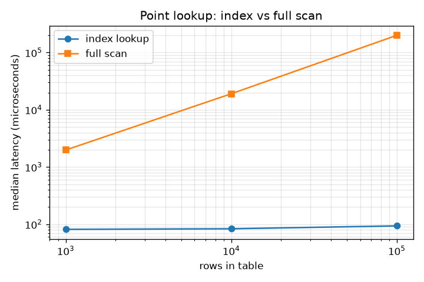
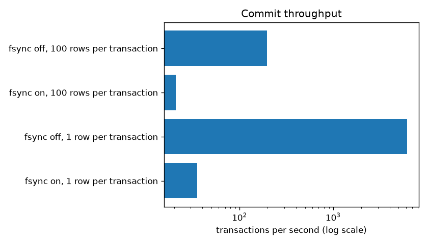
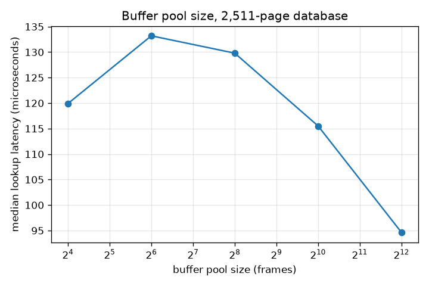
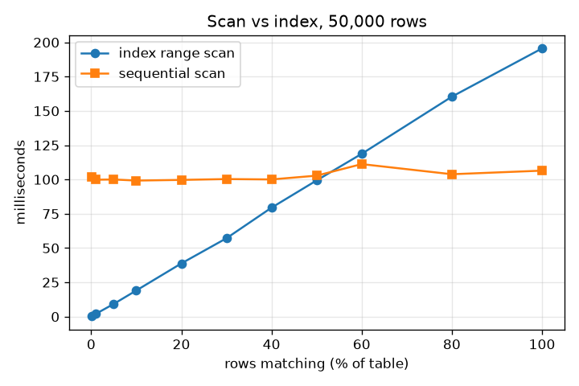

# MVRS_DB benchmark report

Generated 2026-10-12T01:13:57 by `python benchmarks/run_benchmarks.py` (MVRS_DB 0.1.0). Every number below was measured in that run and is stored in `results.json` next to this file.

## Read this first

- **MVRS_DB is written in Python.** It is one to three orders of magnitude slower than engines written in C. The comparisons that mean something here are *internal*: the same engine with and without an index, with and without fsync, with different buffer pool and page sizes.
- **Single run, one machine.** Latencies are medians with p95/p99 over the stated number of samples; throughput figures are from one pass unless a median of several is stated. Expect run-to-run variation of 10-20%.
- **Warm cache unless stated.** Tables are loaded and queried in the same process, so pages are in the buffer pool. "After reopen" means the buffer pool is empty but the operating system's file cache is still warm; a truly cold disk read was not measured because the OS cache cannot be dropped from a normal user process.
- **Timings include SQL parsing**, which is a large share of a point lookup.

## Environment

| Item | Value |
|---|---|
| CPU | 11th Gen Intel(R) Core(TM) i5-11320H @ 3.20GHz (8 logical CPUs) |
| RAM | 15.8 GB |
| Drive | W: HDD / RAID / TOSHIBA MQ04ABF100 |
| OS | Windows 11 (build 10.0.26200) |
| Python | CPython 3.13.7 |
| Windows Defender real-time scanning | on |
| Page size | 4096 bytes unless stated |
| Buffer pool | 16,384 frames (64 MB) unless stated, so data fits in memory |
| Row | `(id INTEGER PRIMARY KEY, grp INTEGER, payload TEXT)`, 60-byte payload |

## 1. Insert throughput

500 rows per `INSERT` statement, each statement its own transaction, `synchronous=False` (no fsync at commit).

| Rows | Seconds | Rows/second | File size | Pages |
|---|---|---|---|---|
| 1,000 | 0.06 | 16,760 | 0.11 MB | 29 |
| 10,000 | 0.55 | 18,310 | 1.00 MB | 255 |
| 100,000 | 6.50 | 15,394 | 9.81 MB | 2,511 |

Reproduce: `python benchmarks/run_benchmarks.py --only load`

## 2. Point lookup: index versus full scan

`SELECT * FROM items WHERE id = k` uses the primary-key B+ tree. `WHERE grp = k` returns the same row but `grp` has no index, so the whole table is read. 2,000 random keys for the index, 15 for the scan. Microseconds.

| Rows | Index median | p95 | p99 | After reopen median | Full scan median | Speedup |
|---|---|---|---|---|---|---|
| 1,000 | 81.3 | 86.2 | 147.5 | 81.4 | 1,978 | 24x |
| 10,000 | 83.1 | 92.9 | 140.0 | 83.2 | 19,056 | 229x |
| 100,000 | 93.4 | 126.5 | 165.6 | 98.1 | 200,053 | 2,142x |

Parsing the lookup statement alone takes a median of 15.4 microseconds, so roughly that much of each index lookup is the SQL front end, not storage. Index latency grows slowly with table size (one more tree level); scan latency grows in proportion to it.

Reproduce: `python benchmarks/run_benchmarks.py --only lookup`

## 3. Range scans and ORDER BY

100,000 rows. Full table scan: **401,427 rows/second**.

| Rows in range | Plan chosen | Milliseconds | Rows/second |
|---|---|---|---|
| 10 | IndexScan | 0.65 | 15,344 |
| 100 | IndexScan | 0.94 | 106,519 |
| 1,000 | IndexScan | 5.04 | 198,460 |
| 10,000 | IndexScan | 47.15 | 212,085 |

| Query | Milliseconds |
|---|---|
| `ORDER BY id LIMIT 10` (walks the index, stops after 10) | 0.27 |
| `ORDER BY grp LIMIT 10` (scans everything, keeps the best 10) | 246.16 |
| `ORDER BY grp` (scans and sorts everything) | 322.43 |

Reproduce: `python benchmarks/run_benchmarks.py --only range`

## 4. Commit throughput: fsync on versus off

Each transaction is one `INSERT` statement. With fsync on, commit returns only after the log is on stable storage, so the drive's sync latency sets the ceiling.

| Configuration | Transactions/s | Rows/s | Median ms | p95 ms | p99 ms |
|---|---|---|---|---|---|
| fsync on, 1 row per transaction | 35 | 35 | 22.98 | 34.07 | 56.21 |
| fsync off, 1 row per transaction | 6,178 | 6,178 | 0.14 | 0.29 | 0.35 |
| fsync on, 100 rows per transaction | 21 | 2,080 | 44.14 | 56.39 | 155.19 |
| fsync off, 100 rows per transaction | 195 | 19,538 | 5.08 | 5.56 | 6.46 |

Batching rows into one transaction is the cheap way to get throughput with durability: the fsync cost is paid once per transaction, not once per row.

Reproduce: `python benchmarks/run_benchmarks.py --only commit`

## 5. Buffer pool size

3,000 random primary-key lookups against a 2,511-page database, reopened with each pool size. A lookup touches the index root, one or two more index pages, and one heap page.

| Frames | Pool memory | Hit ratio | Median us | p95 us | p99 us |
|---|---|---|---|---|---|
| 16 | 0.06 MB | 79.3% | 119.9 | 183.1 | 276.6 |
| 64 | 0.25 MB | 80.8% | 133.2 | 275.9 | 369.2 |
| 256 | 1.00 MB | 83.2% | 129.8 | 237.5 | 313.8 |
| 1,024 | 4.00 MB | 93.0% | 115.5 | 198.5 | 280.4 |
| 4,096 | 16.00 MB | 99.6% | 94.6 | 142.7 | 230.9 |

Misses here are served from the operating system's file cache, not the disk, so the penalty shown is the cost of a system call, a checksum and an eviction. On a cold disk the gap would be far larger.

Reproduce: `python benchmarks/run_benchmarks.py --only buffer_pool`

## 6. Page size

30,000 rows loaded at each page size.

| Page size | Load rows/s | File size | Pages | Index height | Lookup median us | Full scan ms |
|---|---|---|---|---|---|---|
| 4,096 | 17,128 | 2.95 MB | 755 | 2 | 85.7 | 74.2 |
| 8,192 | 16,506 | 2.94 MB | 376 | 2 | 85.3 | 73.8 |
| 16,384 | 15,686 | 2.97 MB | 190 | 2 | 85.8 | 76.7 |
| 32,768 | 13,267 | 3.03 MB | 97 | 2 | 85.4 | 73.9 |

Load throughput is 23% lower at 32,768 bytes than at 4,096, and lookup latency is flat (85 to 86 microseconds). The log is not the reason: with delta records the bytes logged per commit barely change with page size (section 12). Profiling the commit path at 32 KiB showed the largest remaining page-size cost to be comparing a changed page against its earlier copy, which now skips unchanged 1 KiB chunks. Before B+ tree nodes were edited in place (section 14) load throughput fell about five-fold over the same range, from roughly 4,700 to roughly 900 rows per second. At this table size the index has the same height at every page size.

Reproduce: `python benchmarks/run_benchmarks.py --only page_size`

## 7. Cost of maintaining a second index

| Indexes | Rows | Insert rows/s |
|---|---|---|
| primary key only | 30,000 | 17,874 |
| primary key + unique text | 30,000 | 11,374 |

There is no separate `CREATE INDEX`, so index build time is part of loading. Each index adds a uniqueness check and an insert per row.

Reproduce: `python benchmarks/run_benchmarks.py --only index_maintenance`

## 8. Recovery time

Small transactions (10 rows each) with checkpoints disabled, so every change is only in the log. The files are copied while the database is open, which is exactly the state a crash leaves, and the copy is opened.

| Commits in log | Log size | Records | Pages restored | Recovery ms | Clean open+close ms |
|---|---|---|---|---|---|
| 100 | 0.22 MB | 360 | 28 | 110.4 | 133.0 |
| 1,000 | 2.03 MB | 3,545 | 254 | 164.9 | 133.4 |
| 5,000 | 10.05 MB | 17,680 | 1,024 | 444.7 | 99.2 |

Recovery reads the whole log but writes each page once, however many records (images and deltas) the log holds for it. Recovery time therefore follows log size, and the default 8 MB checkpoint threshold bounds it.

Reproduce: `python benchmarks/run_benchmarks.py --only recovery`

## 9. Memory

Peak Python heap measured with `tracemalloc` (which itself slows the run and does not count memory held by the interpreter outside Python objects).

| Pool frames | Pool capacity | Peak while loading | Peak during `SELECT *` |
|---|---|---|---|
| 64 | 0.25 MB | 1.05 MB | 7.34 MB |
| 1,024 | 4.00 MB | 3.85 MB | 10.19 MB |
| 8,192 | 32.00 MB | 3.85 MB | 10.19 MB |

30,000 rows. A result set is materialised in full before `execute()` returns, so `SELECT *` on a large table costs memory in proportion to the result, independent of the buffer pool.

Reproduce: `python benchmarks/run_benchmarks.py --only memory`

## 10. Does the optimiser choose correctly?

`SELECT * FROM items WHERE id < N` on 50,000 rows, for N covering 0.1% to 100% of the table. Both plans were built by hand and timed; the last columns show what the planner picked and what a wrong pick costs.

| Matching | Index scan ms | Seq scan ms | Faster | Planner chose | Correct? |
|---|---|---|---|---|---|
| 0.1% | 0.33 | 101.69 | index | index | yes |
| 1% | 1.95 | 99.82 | index | index | yes |
| 5% | 9.24 | 99.99 | index | index | yes |
| 10% | 19.03 | 99.20 | index | index | yes |
| 20% | 38.78 | 99.68 | index | index | yes |
| 30% | 57.12 | 100.30 | index | index | yes |
| 40% | 79.43 | 100.03 | index | index | yes |
| 50% | 99.28 | 102.78 | index | seq | no (1.04x slower) |
| 60% | 118.69 | 111.20 | seq | seq | yes |
| 80% | 160.36 | 103.83 | seq | seq | yes |
| 100% | 195.54 | 106.44 | seq | seq | yes |

The planner was wrong at 1 of 11 points, all near the crossover, where the two plans cost almost the same; the worst case was 1.04x slower than the better plan.

The crossover is far to the right of what a disk-bound engine would show, because with a warm cache a heap fetch through the index is a dictionary lookup, not a seek. The constants were fitted with `benchmarks/calibrate_optimizer.py`.

Reproduce: `python benchmarks/run_benchmarks.py --only crossover`

## 11. SQLite, for scale only

> **SQLite 3.50.4 is written in C. MVRS_DB is written in Python.** These numbers show the size of that gap. They are not a contest, and nothing here suggests MVRS_DB could replace SQLite.

Identical SQL statements, 100,000 rows, one transaction per 500-row `INSERT`, no fsync on either side (MVRS_DB `synchronous=False`; SQLite `PRAGMA synchronous=OFF` with its default rollback journal), then 2,000 primary-key lookups and a full scan.

| Operation | MVRS_DB | SQLite | SQLite is faster by |
|---|---|---|---|
| Insert, rows/second | 15,802 | 352,006 | 22x |
| Point lookup, median microseconds | 94.6 | 26.9 | 4x |
| Full scan, milliseconds | 254.5 | 71.2 | 4x |

Reproduce: `python benchmarks/run_benchmarks.py --only sqlite`

## 12. Delta log records

Each workload runs on a fresh database with `log_deltas=False` (a whole page logged for every changed page) and with `log_deltas=True` (only the bytes that changed, except for new pages, the first change to a page after a checkpoint, and changes of more than half a page). `synchronous=False`, so the timings show the cost of building and writing log records and not the drive's fsync. Checkpoints are off, so the recovery column replays every commit.

| Workload | Log size, images | Log size, deltas | Smaller by | Bytes per commit (deltas) | Commits/s, images | Commits/s, deltas | Recovery ms, images | Recovery ms, deltas |
|---|---|---|---|---|---|---|---|---|
| 3,000 single-row inserts | 24.04 MB | 1.00 MB | 24.0x | 350 | 6,112 | 6,224 | 266 | 134 |
| 60 inserts of 500 rows | 3.68 MB | 3.27 MB | 1.1x | 57,213 | 32 | 33 | 165 | 165 |
| 1,500 single-row updates | 6.17 MB | 0.44 MB | 14.0x | 315 | 3,045 | 3,958 | 200 | 121 |
| 1,500 single-row deletes | 12.22 MB | 0.88 MB | 13.9x | 615 | 3,644 | 3,682 | 167 | 111 |

Page size, 3,000 single-row inserts:

| Page size | Bytes per commit, images | Bytes per commit, deltas | Commits/s, deltas |
|---|---|---|---|
| 4,096 | 8,401 | 350 | 6,224 |
| 16,384 | 32,988 | 361 | 5,808 |
| 32,768 | 65,761 | 376 | 5,052 |

What the numbers show:

- **The log shrinks a lot for small changes**: a single-row insert or update logs a few hundred bytes instead of two or three pages.
- **Throughput with fsync off barely depends on the log format.** The ratio (deltas over whole pages) ran from 1.01 to 1.30 across workloads in this run. The same workload has varied by about 15% between runs on this machine, so differences of that size mean nothing. Building the log record is a small part of the cost of a commit.
- **Commit time with fsync on was about the same.** 150 durable single-row inserts took a median of 22.7 ms per commit with whole pages (8.4 KB logged per commit) and 22.8 ms with deltas (0.3 KB). The drive's sync latency dominates, and it varies from run to run: across several runs on this machine the two modes were within a few percent of each other in most and about 40% apart in one, so a single run cannot separate a real effect from disk variance. A drive with fast syncs, such as an SSD, might show a difference; this one is a hard disk.
- **Deletes shrank 13.9 times.** Removing a key from a B+ tree node used to rewrite the whole node (about 3 times smaller than whole pages); now it closes one gap in the pointer array and leaves the cell as a hole (section 14).
- **Bulk inserts barely benefit** (about 1.1 times smaller): most of what they write is new pages, which are always logged whole.
- **The log no longer grows with the page size** (compare bytes per commit in the table above).
- **Recovery was faster where the log shrank most**: for single-row inserts and updates it took 1.7 to 2.1 times less time in each of two runs, since there is less to read. For deletes and bulk inserts it varied between no change and a modest gain, within the noise.

Reproduce: `python benchmarks/log_volume.py`

## 13. Group commit

Each thread runs durable single-row `INSERT` transactions (fsync on) into one table for a fixed time. With one thread every commit pays for its own fsync. With several, commits that arrive while an fsync is running queue up and share the next one.

| Threads | Commits/s | Versus one thread | Commits per fsync | Median ms | p99 ms |
|---|---|---|---|---|---|
| 1 | 40 | 1.0x | 1.0 | 22.6 | 33.9 |
| 2 | 58 | 1.4x | 1.5 | 23.1 | 111.0 |
| 4 | 98 | 2.4x | 2.5 | 44.1 | 89.1 |
| 8 | 169 | 4.2x | 4.5 | 44.9 | 147.6 |
| 16 | 320 | 8.0x | 8.5 | 45.9 | 165.9 |

Throughput rises with the number of threads because each fsync now serves several commits. **Latency rises as well**: a commit waits for a shared batch and not only for its own fsync, so the median grows even as total throughput does. A single thread is unaffected. The gain is bounded by how many commits overlap, and the hard disk's fsync time sets the scale; a drive with fast syncs would show a smaller gain.

Reproduce: `python benchmarks/group_commit.py`

## 14. B+ tree edits in place

30,000 random keys inserted into a tree held entirely in memory, then looked up, then half deleted. Before: every insert and delete decoded the whole node into lists and rewrote it. After: the node page is edited in place, and only a split rewrites it. "Log bytes" is the size of the delta record the commit path would write for one operation (sampled over 2,000 operations).

| Measurement | Before | After | Improvement |
|---|---|---|---|
| insert, 4,096-byte pages | 235 us | 18 us | 13x |
| delete, 4,096-byte pages | 161 us | 17 us | 10x |
| log bytes, random insert, 4,096-byte pages (median) | 735 | 137 | 5.4x |
| log bytes, delete, 4,096-byte pages (median) | 705 | 121 | 5.8x |
| insert, 32,768-byte pages | 1,536 us | 17 us | 88x |
| delete, 32,768-byte pages | 1,454 us | 18 us | 83x |
| log bytes, random insert, 32,768-byte pages (median) | 7,162 | 993 | 7.2x |
| log bytes, delete, 32,768-byte pages (median) | 6,780 | 928 | 7.3x |

The cost of an insert or delete no longer depends on the page size. The log bytes still grow with the page, because the pointer array is shifted by one entry from the insertion point and the array is longer on a bigger page. Appending in key order moves no pointers.

Reproduce: `python benchmarks/btree_ops.py`. The "before" results are kept in `benchmarks/results/btree_ops_before.json`.

## Known bottlenecks

- **Whole-page log images remain for new pages, for the first change to a page after a checkpoint, and for changes of more than half a page** (section 12). Bulk loads are mostly new pages.
- **A durable commit still costs an fsync.** Commits that overlap share one (section 13), but a lone commit pays for its own, and a commit's latency now depends on the batch it joins.
- **B+ tree splits decode and re-encode the node whole.** Inserts and deletes that do not split edit the page in place (section 14).
- **Row-at-a-time execution.** Each row passes through a Python generator per operator and is decoded into a tuple even if most columns are unused.
- **Results are materialised** before being returned.
- **The SQL text is parsed on every call.** There are no prepared statements.
- **Single writer.** Write throughput does not scale with threads, and the GIL prevents read scaling as well.

## What was not measured

- Cold-disk performance, and behaviour once the database is larger than RAM.
- Power-loss durability. `fsync` is called; whether the drive honours it was not tested.
- Concurrent throughput. The concurrency tests check correctness, not speed.
- Skewed data. The optimiser assumes evenly spread values, and every dataset here is evenly spread.
